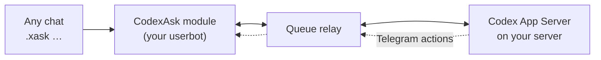

<div align="center">

# CodexAsk

**Codex inside your own Telegram chats — type `.xask`, and the answer appears in place of your message.**

[Install](#install) · [Commands](#commands) · [Triggers](#triggers-the-assistant-that-watches-a-chat) · [Remote userbot](#userbot-on-another-server) · [Troubleshooting](#troubleshooting)

Part of **[Telegram AI](https://github.com/maleon17/telegram-ai)** — Claude Code and Codex from Telegram, on your own subscription.

</div>

---

CodexAsk is a module for a Telegram **userbot** (your own account, automated) plus a Codex backend on your server. In any chat you write `.xask what does this error mean?` — your message turns into a live progress view and then into the answer, as if you had typed it yourself. There is no separate bot to talk to: it lives in the conversations you already have.



It runs on your ChatGPT/Codex subscription through the official Codex CLI, with a long-lived Codex App Server behind it. The backend never holds your Telegram account: when Codex wants to *do* something in Telegram, the request goes back to your userbot, which performs it and reports the real result.

> Looking for a dedicated bot chat instead? That is **[Codex Telegram Bridge](https://github.com/maleon17/codex-telegram-bridge)**. Prefer Claude? **[ClaudeAsk](https://github.com/maleon17/claude-ask)** is the same thing with `.ask` — the `x` prefix lets both run side by side.

## What it can do

- **Answers in place**, in private chats and groups, with your chat's history as context.
- **Real Telegram actions** in your account: read and search chat history, send messages and files, create groups and channels, invite people, manage contacts, forward messages.
- **Sees attachments**: replies to photos, documents, stickers and voice messages (voice is transcribed); images Codex generates are sent back automatically.
- **Remembers each chat** — a persistent Codex thread per chat; `.xnew` starts over.
- **Triggers** — rules that watch a chat and react on their own (see below).
- **Stoppable** — `.xstop` interrupts a turn that is taking too long.

## Install

**You need:** a Linux server with `systemd`, `git` and Python 3.10+; the [Codex CLI](https://developers.openai.com/codex/cli/) logged in with `codex login`; and a [Heroku](https://github.com/coddrago/Heroku) userbot — the installer can create one for you in Docker.

**1. Install the backend:**

```bash
git clone https://github.com/maleon17/codex-ask.git
cd codex-ask
./setup.sh
```

The installer fetches the shared [telegram-ai-core](https://github.com/maleon17/telegram-ai-core) next to this folder (or reuses the relay ClaudeAsk already installed), starts the Codex worker as a service, and asks for:

- your name and Telegram ID (for the persona — get the ID from [@userinfobot](https://t.me/userinfobot));
- an **instance ID** — any short name for your userbot, like `mybot` (use the same one as for ClaudeAsk if both live in one userbot).

Codex gets its own empty working folder (`workspace/`) by default, so an `AGENTS.md` written for other work does not leak into its answers.

At the end it prints the three commands you will paste into Telegram — **copy them now**, the token is shown only once.

**2. Get a userbot.** The installer's last question offers to create one: answer `1` for a local Docker userbot (you will sign in to Telegram once, right in the terminal), `2` if your userbot runs on another server (see [below](#userbot-on-another-server)), or `n` if you already have one on this server.

**3. Load the modules and connect them.** Send `jarvis_ask.py` and then `codex_ask.py` as files to your **Saved Messages**, reply to each with `.lm`, then in the same private chat run the commands the installer printed:

```text
.xasknet token <token>
.xasknet local mybot
.xasknet check
```

`.xasknet check` should answer ✅. That's it — try `.xask hello` in any chat.

> Until the module is configured, every command answers with these setup instructions. All settings are also in the userbot's own editor: `.cfg CodexAsk`.

## Commands

| Command | What it does |
|---|---|
| `.xask <question>` | Ask Codex; reply to a message or file to include it |
| `.xsearch <word>` | Find messages in this chat and answer about them |
| `.xtranslate <text>` | Translate into Russian |
| `.xstop` | Stop the running request in this chat (reply to its message to stop just that one) |
| `.xnew` | Forget this chat's conversation and start fresh |
| `.xpersona` | View or edit the assistant's persona; reply to a file or text to replace it, `.xpersona reset` to restore |
| `.xasknet` | Connection settings: `token`, `local`, `tailnet`, `custom`, `check`, `testbot` |

## Triggers: the assistant that watches a chat

Ask in plain words — *"in this group, delete ads and messages with buttons"*, *"tell me when Alex replies"*, *"answer Alex for me until the question is settled"* — and Codex registers a trigger: a cheap filter (keywords, links, buttons, any message) plus what to do (notify you, reply, delete, post to a topic, run an agent, or ask you to confirm with buttons). Fuzzy conditions like "is this an ad?" are checked by a small model only for messages that passed the filter.

Triggers are shared with ClaudeAsk, and each one says which engine runs it. With the `JarvisAsk` coordinator (`jarvis_ask.py`) loaded, one incoming message fires one coordinated action — never a duplicate from each assistant. Priority: `delete > confirm > post > agent > reply`. If one engine fails outright, the other takes over; a timeout or a `.xstop` is never silently retried.

Triggers run unattended, so they are deliberately limited: by default a trigger may only send a message to the chat it fired in, and it can never hand tasks to other agents.

## Userbot on another server

If your userbot runs elsewhere, the two servers talk over [Tailscale](https://tailscale.com):

1. On **this** server, answer `2` to the installer's last question — it installs Tailscale, logs this server into your tailnet and lets the relay listen there.
2. In the **userbot's container**, Tailscale must be installed (add it to its image, so it survives a rebuild):
   ```dockerfile
   RUN curl -fsSL https://tailscale.com/install.sh -o /tmp/ts.sh && sh /tmp/ts.sh && rm /tmp/ts.sh
   ```
   The container needs a persistent `/data` volume; the module starts Tailscale there on every load.
3. Connect the module and log the container in once:
   ```text
   .xasknet token <token>
   .xasknet tailnet mybot http://<this-server-tailnet-ip>:9092
   ```
   ```bash
   docker exec -it <userbot-container> tailscale --socket=/var/run/tailscale/tailscaled.sock up
   ```
   Open the printed link to approve the device, then run `.xasknet check`.

## Troubleshooting

| Symptom | What to check |
|---|---|
| `.xask` answers with setup instructions | The module is not configured yet: run the `.xasknet` commands from the installer |
| `.xasknet check` fails | It names the problem: no route to the backend, a wrong token, or a token of another instance |
| `setup.sh` says the relay is missing | It could not install telegram-ai-core: check `git` and network access, or set `TELEGRAM_AI_CORE_DIR` |
| Stuck on "thinking" | `journalctl -u codex-jarvis -f` on the server; `.xstop` ends the request |
| Telegram actions do nothing | `journalctl -u jarvis-ask-cmd-queue -f`; the userbot must be online to perform them |
| Lost the token | Run `./setup.sh` again with the same instance ID — it issues a new one |

<details>
<summary><b>Together with the rest of Telegram AI</b></summary>

When other [Telegram AI](https://github.com/maleon17/telegram-ai) parts are installed on the same server, they connect on their own:

- **ClaudeAsk** shares the relay and the trigger rules (see the coordinator above).
- **Claude / Codex Telegram Bridge**: in your own `.xask` you can hand a bigger task to your coding agent in the bridge (it has your projects and no ten-minute limit) and get its answer back. Only the instance's owner can do this — never a trigger or another person. And in your bridge chat, the agent can act in your Telegram account through this userbot.

</details>

<details>
<summary><b>Updating</b></summary>

```bash
git pull && git -C ../telegram-ai-core pull
sudo systemctl restart codex-jarvis   # when no .xask is running
```

Reload the module in the userbot:

```text
.dlm https://raw.githubusercontent.com/maleon17/codex-ask/main/codex_ask.py
```

Settings survive module updates. `codex_ask.py` and `jarvis_ask.py` are built in telegram-ai-core — change them there, not here.

</details>

<details>
<summary><b>Settings, files and manual setup</b></summary>

- **Voice transcription** uses Mistral's Voxtral API: put a key into `.cfg CodexAsk` → `mistral_api_key`.
- **Persona**: `personas/<instance>.md` on the server (git-ignored), re-read automatically; the template is `personas/default.md.example`.
- **Codex home**: `codex_home/` holds this worker's own `config.toml` (an existing one is kept on re-install; the fresh one is written next to it as `config.toml.new`) and a link to your Codex login.
- **Worker settings** (environment): `CODEX_JARVIS_MODEL`, `CODEX_JARVIS_CLASSIFY_MODEL`, `CODEX_JARVIS_SANDBOX`, `CODEX_JARVIS_CWD`.
- **Relay credentials, state directory, registry**: see [telegram-ai-core](https://github.com/maleon17/telegram-ai-core).
- **Unattended install**: every `setup.sh` question can be answered through the environment — the variables are listed at the top of the script.

Manual setup: install the relay from telegram-ai-core (`./install_relay.sh`, `./register_instance.sh <instance> <owner_id> ~/.config/telegram-ai/relay-token-codex.env`), create `codex_home/` from `codex-config.toml.example`, then fill in the placeholders of `codex-jarvis.service.example` and enable it.

Tests: `./scripts/run_tests.sh` (the worker; the relay and modules are tested in telegram-ai-core).

</details>

## License

MIT, see [LICENSE](LICENSE).
