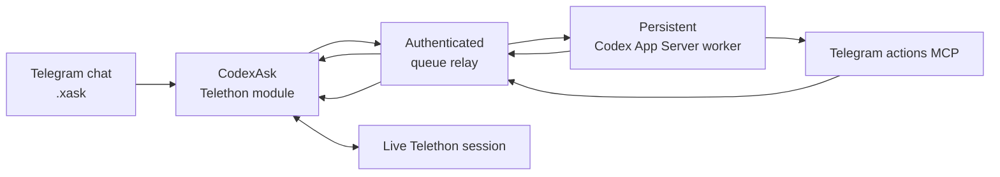

# CodexAsk

> Part of **[Telegram AI](https://github.com/maleon17/telegram-ai)** — Claude/Codex from dedicated bots or directly inside your Telegram account.

**Run Codex from ordinary Telegram chats through your own account.**

CodexAsk combines a Telethon/Hikka userbot module with a persistent Codex App Server worker. Type `.xask` in a conversation and the request goes to the backend while the userbot remains the controlled execution point for real Telegram actions.

This is not **[codex-telegram-bridge](https://github.com/maleon17/codex-telegram-bridge)**. That project gives Codex a dedicated Bot API chat. CodexAsk puts the agent inside the Telegram account and conversations you already use.

## Architecture



Telegram actions are not imaginary model side effects. MCP calls are queued back to the loaded module, executed through its real Telethon session, and return a real tool result before the final agent response is produced.

The module submits `.xask` work to the shared relay's `/xask` endpoint, with progress and answers returned through `/tmp/jarvisask_xask_*`. Telegram tool calls use `/tmp/jarvisask_tool_queue`; the relay also exposes `/xreset` for resetting CodexAsk context.

## What is included

- `codex_ask.py` — loadable `CodexAsk` module
- `codex_ask_watcher.py` — persistent Codex App Server worker
- `telegram_actions_mcp.py` — MCP tools for real Telegram actions
- `app_server.py` — minimal JSONL client for Codex App Server
- `setup.sh` and `codex-jarvis.service.example` — worker installation

## Commands and isolation

CodexAsk deliberately uses `x`-prefixed commands so it can coexist with ClaudeAsk:

- `.xask`
- `.xsearch`
- `.xtranslate`
- `.xnew`

Codex history has its own `CodexAsk` namespace and `instance_id`.

Trigger storage is shared with ClaudeAsk. When both userbot modules and the shared `JarvisAsk` coordinator are loaded, each module's watcher calls the coordinator; it selects the engine from a trigger's `engine` field. One incoming message then produces one coordinated action rather than duplicate Claude/Codex reactions.

The coordinator's action priority is:

`delete > confirm > post > agent > reply`

Fallback occurs only on explicit structured backend failures. Timeouts are reported without silently switching engines, and agent/reply triggers fail closed.

## Setup

Requirements:

- Linux with Python 3.10+
- `systemd` and `sudo`
- Codex CLI installed and authenticated with `codex login`
- shared queue relay exposing `/xask`, `/xreset` and Telegram tool endpoints — normally the ClaudeAsk checkout's `cmd_queue.py`, see [Relay credentials](#relay-credentials)
- supported Telethon/Hikka userbot; this project targets [Heroku](https://github.com/coddrago/Heroku)

Heroku may run on the backend host or in Docker on a separate host.

```bash
git clone https://github.com/maleon17/codex-ask.git
cd codex-ask
chmod +x setup.sh
./setup.sh
```

`setup.sh` does everything on the backend side in one pass:

- creates a dedicated `CODEX_HOME`, MCP virtual environment and local `config.toml`, and links authentication from `$HOME/.codex/auth.json` (never copied into Git)
- writes the persona env (`jarvis.env`)
- if it finds a ClaudeAsk checkout (prompts for the path, default `~/claude-jarvis`), registers an owner and generates a relay token for an `instance_id` you choose (1–64 letters/digits/`_`/`-`, starting with a letter or digit), restarting the shared relay so it takes effect — printing the exact `.xasknet` commands to paste into Telegram at the end; otherwise it tells you to do that step by hand on whichever host runs the relay
- installs and starts the worker's systemd service (skipping it if a service by that name is already active, so re-running to add a second instance is safe)
- optionally builds the graphify code map
- optionally builds and starts a local Docker userbot container (Heroku image, first-run Telegram sign-in included), or configures Tailscale on this host for a remote userbot

Runtime paths such as `codex_home/`, `state/` and `.venv/` are gitignored. The only things it cannot do for you: the Codex login itself, and anything that has to happen inside Telegram (loading the modules, running `.xasknet`, the userbot's own first-time Telegram sign-in if you're not using the Docker option).

## Load the userbot modules

Load `jarvis_ask.py` first, then `codex_ask.py`, as Telegram documents into the userbot's test channel. Reply to each with:

```text
.lm
```

Then run `.xasknet` with the exact `<token>` and `<instance_id>` `setup.sh` printed to your terminal a moment ago (or that `cmd_queue.py --add-token <instance_id>` printed, if you generated them by hand on the relay's host — see [Relay credentials](#relay-credentials)). That token is shown once and stored nowhere else in plaintext; if you lost it, re-run `setup.sh` or `cmd_queue.py --add-token` again to mint a new one for the same instance:

```text
.xasknet token <token>
.xasknet local <instance_id>
```

or:

```text
.xasknet tailnet <instance_id> <backend_url>
```

Send the token command in a private chat, not a group. A single userbot can share the same `instance_id`/token between ClaudeAsk and CodexAsk; separate userbots each need their own.

### Remote userbot over Tailscale

The **remote userbot container** must also have `tailscale` and `tailscaled` installed and join the same tailnet. Install the package in its Docker image so container recreation does not remove the binaries. For an Ubuntu/Debian-based image, add a build step like this before starting Heroku:

```dockerfile
RUN apt-get update && apt-get install -y --no-install-recommends curl ca-certificates \
    && curl -fsSL https://tailscale.com/install.sh -o /tmp/tailscale-install.sh \
    && sh /tmp/tailscale-install.sh \
    && rm /tmp/tailscale-install.sh
```

The Ask module starts `tailscaled` in [userspace networking mode](https://tailscale.com/docs/concepts/userspace-networking) on module load, with an HTTP proxy at `localhost:1056`. It requires a persistent `/data` mount for `/data/tailscale/tailscaled.state`. Set `.xasknet tailnet <instance_id> http://<backend-tailnet-ip>:9092` and `.xasknet token <token>`, then reload the module so `client_ready` starts the local Tailscale proxy. Run the first interactive login inside that container:

```bash
docker exec -it <userbot-container> tailscale --socket=/var/run/tailscale/tailscaled.sock up
```

Open the URL Tailscale prints and approve the device. The module can restart a previously authenticated daemon, but it cannot install Tailscale or perform the first login for you.

These settings live in the userbot's persistent configuration rather than environment variables.

## Relay credentials

Each instance uses a bearer token. `.xasknet token` stores it in the userbot configuration and never displays it afterward.

The local MCP worker receives either `JARVIS_RELAY_TOKEN` or `JARVIS_RELAY_TOKENS_JSON` from a root-owned environment file (`/etc/jarvis-ask/relay-token.env` by default) referenced by the worker's systemd unit. Do not put relay tokens into `codex-config.toml` or commit them to the repository.

`setup.sh` generates this token for you when it can reach the relay's `cmd_queue.py` (same host as this worker, in the ClaudeAsk checkout) — see the [Setup](#setup) walkthrough above. On a genuinely split deployment, generate it on the relay's own host instead, following ClaudeAsk's [Relay authentication](https://github.com/maleon17/claude-ask#relay-authentication-and-trust-boundary), then put the token in `/etc/jarvis-ask/relay-token.env` on this host yourself.

## Manual setup (without setup.sh)

Everything `setup.sh` automates, as raw commands, for anyone who wants full control or is scripting a different deployment.

Workspace, `CODEX_HOME` and MCP dependencies:

```bash
CODEX_CWD="$HOME"                      # or wherever Codex should treat as its working directory
CODEX_HOME_DIR="$PWD/codex_home"
mkdir -p "$CODEX_HOME_DIR" && chmod 700 "$CODEX_HOME_DIR"
ln -s "$HOME/.codex/auth.json" "$CODEX_HOME_DIR/auth.json"

python3 -m venv .venv
.venv/bin/python -m pip install --upgrade pip
.venv/bin/python -m pip install -r requirements-mcp.txt
sed -e "s|__MCP_PYTHON__|$PWD/.venv/bin/python|g" -e "s|__INSTALL_DIR__|$PWD|g" \
    codex-config.toml.example > "$CODEX_HOME_DIR/config.toml"
```

Relay token, generated on whichever host runs `cmd_queue.py` (see ClaudeAsk's [manual setup](https://github.com/maleon17/claude-ask#manual-setup-without-setupsh) for the owner-registration half of this), then copied here:

```bash
echo "JARVIS_RELAY_TOKEN=<printed token>" | sudo tee /etc/jarvis-ask/relay-token.env
sudo chmod 600 /etc/jarvis-ask/relay-token.env
```

systemd service, after replacing `__USER__`, `__INSTALL_DIR__`, `__CODEX_HOME__` and `__CODEX_CWD__` in `codex-jarvis.service.example`:

```bash
sudo install -m 0644 codex-jarvis.service.example /etc/systemd/system/codex-jarvis.service
sudo systemctl daemon-reload
sudo systemctl enable --now codex-jarvis.service
```

For the userbot side (local Docker or remote Tailscale), see ClaudeAsk's equivalent manual steps — the Dockerfile/compose files and Tailscale commands are shared between both products.

Then continue from [Load the userbot modules](#load-the-userbot-modules).

## Updating

Reload the latest module from `main` with:

```text
.dlm https://raw.githubusercontent.com/maleon17/codex-ask/main/codex_ask.py
```

Saved `.xasknet` settings remain in the userbot database.

## Verification

```bash
./scripts/run_tests.sh
systemctl status codex-jarvis
journalctl -u codex-jarvis -f
```

After loading the module, test a plain `.xask` and at least one request that requires a real Telegram tool such as `list_triggers`, `read_history`, or `search_chat`.

The final response is produced only after the real tool result is available rather than trusting the model's own claim that an action happened. A strangely high bar for software, yet here we are.

`requirements-dev.txt` declares pytest; CI runs the same checks without secrets or live services. CodexAsk and ClaudeAsk each have a watcher, while the coordinator has none of its own.

## Product boundaries

- **CodexAsk**: this repository; Telethon userbot + persistent Codex backend.
- **[ClaudeAsk](https://github.com/maleon17/claude-ask)**: separate Claude backend/userbot with coordinated shared infrastructure.
- **[Codex Telegram Bridge](https://github.com/maleon17/codex-telegram-bridge)**: independent Bot API frontend with its own sessions and runtime.

Only selected relay/trigger infrastructure is deliberately shared.

See **[Telegram AI](https://github.com/maleon17/telegram-ai)** for the complete ecosystem.

## License

MIT, see [LICENSE](LICENSE).
