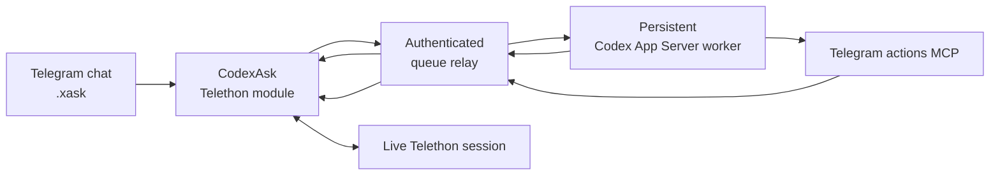

# CodexAsk

> Part of **[Telegram AI](https://github.com/maleon17/telegram-ai)** — Claude/Codex from dedicated bots or directly inside your Telegram account.

**Run Codex from ordinary Telegram chats through your own account.**

CodexAsk combines a Telethon/Hikka userbot module with a persistent Codex App Server worker. Type `.xask` in a conversation and the request goes to the backend while the userbot remains the controlled execution point for real Telegram actions.

This is not **[codex-telegram-bridge](https://github.com/maleon17/codex-telegram-bridge)**. That project gives Codex a dedicated Bot API chat. CodexAsk puts the agent inside the Telegram account and conversations you already use.

## Architecture



Telegram actions are not imaginary model side effects. MCP calls are queued back to the loaded module, executed through its real Telethon session, and return a real tool result before the final agent response is produced.

## What is included

- `codex_ask_watcher.py` — persistent Codex App Server worker
- `app_server.py` — minimal JSONL client for Codex App Server
- `codex_ask.py` — the loadable `CodexAsk` module (generated; see below)
- `jarvis_ask.py` — the `JarvisAsk` coordinator module
- `personas/` — the persona template
- `setup.sh` and `codex-jarvis.service.example` — worker installation

The queue relay, the Telegram-action MCP server and the source of both userbot modules live in **[telegram-ai-core](https://github.com/maleon17/telegram-ai-core)**, shared with [ClaudeAsk](https://github.com/maleon17/claude-ask). `setup.sh` fetches it for you. `codex_ask.py` and `jarvis_ask.py` here are copies built from there — do not edit them by hand.

## Commands and isolation

CodexAsk deliberately uses `x`-prefixed commands so it can coexist with ClaudeAsk:

- `.xask <question>` — ask Codex
- `.xsearch <word>`, `.xtranslate <text>`
- `.xstop` — stop the request in this chat (as a reply to its message: only that one)
- `.xnew` — start a fresh Codex context
- `.xpersona` — view or replace the persona
- `.xasknet` — connection settings; `.xasknet check` verifies them

Codex history has its own `CodexAsk` namespace and `instance_id`.

Trigger storage is shared with ClaudeAsk. When both userbot modules and the `JarvisAsk` coordinator are loaded, each module's watcher calls the coordinator; it selects the engine from a trigger's `engine` field. One incoming message then produces one coordinated action rather than duplicate Claude/Codex reactions.

The coordinator's action priority is:

`delete > confirm > post > agent > reply`

Fallback occurs only on explicit structured backend failures. Timeouts are reported without silently switching engines, a request stopped with `.xstop` is never retried on the other engine, and agent/reply triggers fail closed.

## Setup

Requirements:

- Linux with Python 3.10+ (and its `venv` module), `git`
- `systemd` and `sudo` (only to install the service units)
- Codex CLI installed and authenticated with `codex login`
- a supported Telethon/Hikka userbot; this project targets [Heroku](https://github.com/coddrago/Heroku)

Nothing else from this ecosystem has to be installed first. Heroku may run on the backend host or in Docker on a separate host.

```bash
git clone https://github.com/maleon17/codex-ask.git
cd codex-ask
./setup.sh
```

`setup.sh` does everything on the backend side in one pass:

- finds `telegram-ai-core` next to this checkout, or clones it there, and installs the queue relay from it (a relay that is already running — for example one ClaudeAsk installed — is reused)
- creates a dedicated `CODEX_HOME` with its `config.toml` (an existing one is kept; the fresh one is written next to it as `config.toml.new`) and links authentication from `$HOME/.codex/auth.json` (never copied into Git)
- gives Codex a dedicated, initially empty working directory by default, so an `AGENTS.md` written for other work does not leak into Jarvis's answers
- writes the persona env (`jarvis.env`), keeping any other keys already in that file
- registers an owner and generates a relay token for an `instance_id` you choose (1–64 letters/digits/`_`/`-`, starting with a letter or digit), then prints the exact `.xasknet` commands to paste into Telegram
- installs and starts the worker's systemd service (skipping it if a service by that name is already active, so re-running to add a second instance is safe)
- optionally builds the graphify code map
- optionally builds and starts a local Docker userbot container (Heroku image, first-run Telegram sign-in included), or configures Tailscale on this host for a remote userbot

Runtime paths such as `codex_home/`, `state/` and `workspace/` are gitignored. Every question can also be answered through environment variables (listed at the top of `setup.sh`), so the install can run unattended. The only things it cannot do for you: the Codex login itself, and anything that has to happen inside Telegram (loading the modules, running `.xasknet`, the userbot's own first-time Telegram sign-in if you're not using the Docker option).

## Load the userbot modules

Load `jarvis_ask.py` first, then `codex_ask.py`, as Telegram documents into the userbot. Reply to each with:

```text
.lm
```

Then, in a private chat, run the commands `setup.sh` printed:

```text
.xasknet token <token>
.xasknet local <instance_id>
.xasknet check
```

or, for a backend on another host:

```text
.xasknet tailnet <instance_id> <backend_url>
```

The token is shown once and stored nowhere else in plaintext; if you lost it, re-run `setup.sh` to mint another one for the same instance (older tokens stay valid until revoked). A single userbot can share one `instance_id` between ClaudeAsk and CodexAsk; separate userbots each need their own.

Until it is configured, the module answers every command with these setup instructions instead of guessing a backend. The same settings are available in the userbot's own config editor: `.cfg CodexAsk`.

### Remote userbot over Tailscale

The **remote userbot container** must also have `tailscale` and `tailscaled` installed and join the same tailnet. Install the package in its Docker image so container recreation does not remove the binaries. For an Ubuntu/Debian-based image, add a build step like this before starting Heroku:

```dockerfile
RUN apt-get update && apt-get install -y --no-install-recommends curl ca-certificates \
    && curl -fsSL https://tailscale.com/install.sh -o /tmp/tailscale-install.sh \
    && sh /tmp/tailscale-install.sh \
    && rm /tmp/tailscale-install.sh
```

The Ask module starts `tailscaled` in [userspace networking mode](https://tailscale.com/docs/concepts/userspace-networking) on module load, with an HTTP proxy at `localhost:1056`. It requires a persistent `/data` mount for `/data/tailscale/tailscaled.state`. Set `.xasknet tailnet <instance_id> http://<backend-tailnet-ip>:9092` and `.xasknet token <token>`, then reload the module so `client_ready` starts the local Tailscale proxy. Run the first interactive login inside that container:

```bash
docker exec -it <userbot-container> tailscale --socket=/var/run/tailscale/tailscaled.sock up
```

Open the URL Tailscale prints and approve the device. The module can restart a previously authenticated daemon, but it cannot install Tailscale or perform the first login for you.

## Relay credentials

Each instance uses a bearer token. `.xasknet token` stores it in the module config and never displays it afterward.

The worker's own Telegram MCP client authenticates to the relay with `JARVIS_RELAY_TOKENS_JSON` (an `instance_id` → token map). `setup.sh` writes it to `relay-token-codex.env` in the shared configuration directory (`~/.config/telegram-ai` by default, mode `0600`), and the worker's systemd unit loads it through `EnvironmentFile=`. Do not put relay tokens into `codex-config.toml` or commit them to the repository.

Owners, tokens and the trust boundary are documented in [telegram-ai-core](https://github.com/maleon17/telegram-ai-core#relay-authentication).

## Updating

```bash
git pull && git -C ../telegram-ai-core pull
sudo systemctl restart codex-jarvis     # once no .xask is in flight
```

Reload the module in the userbot with:

```text
.dlm https://raw.githubusercontent.com/maleon17/codex-ask/main/codex_ask.py
```

Settings persist in the userbot database.

## Verification

```bash
./scripts/run_tests.sh
systemctl status codex-jarvis
journalctl -u codex-jarvis -f
```

After loading the module, try `.xasknet check`, a plain `.xask`, `.xstop` on a long one, and at least one request that requires a real Telegram tool such as `list_triggers`, `read_history`, or `search_chat`.

The final response is produced only after the real tool result is available rather than trusting the model's own claim that an action happened. A strangely high bar for software, yet here we are.

The tests here cover the worker; the relay, the MCP server and the userbot modules are tested in telegram-ai-core.

## Product boundaries

- **CodexAsk**: this repository; the Codex worker and its installer.
- **[telegram-ai-core](https://github.com/maleon17/telegram-ai-core)**: relay, Telegram-action MCP server, userbot module source — shared with ClaudeAsk.
- **[ClaudeAsk](https://github.com/maleon17/claude-ask)**: the Claude backend for the same userbot workflow. Installable alone or next to this one.
- **[Codex Telegram Bridge](https://github.com/maleon17/codex-telegram-bridge)**: independent Bot API frontend with its own sessions and runtime.

See **[Telegram AI](https://github.com/maleon17/telegram-ai)** for the complete ecosystem.

## License

MIT, see [LICENSE](LICENSE).
