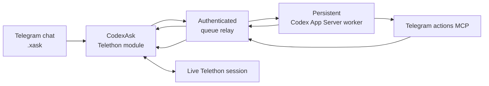

# CodexAsk

> Part of **[Telegram AI](https://github.com/maleon17/telegram-ai)** — Claude/Codex from dedicated bots or directly inside your Telegram account.

**Run Codex from ordinary Telegram chats through your own account.**

CodexAsk combines a Telethon/Hikka userbot module with a persistent Codex App Server worker. Type `.xask` in a conversation and the request goes to the backend while the userbot remains the controlled execution point for real Telegram actions.

This is not **[codex-telegram-bridge](https://github.com/maleon17/codex-telegram-bridge)**. That project gives Codex a dedicated Bot API chat. CodexAsk puts the agent inside the Telegram account and conversations you already use.

## Architecture



Telegram actions are not imaginary model side effects. MCP calls are queued back to the loaded module, executed through its real Telethon session, and return a real tool result before the final agent response is produced.

The module submits `.xask` work to the shared relay's `/xask` endpoint, with progress and answers returned through `/tmp/jarvisask_xask_*`. Telegram tool calls use `/tmp/jarvisask_tool_queue`; the relay also exposes `/xreset` for resetting CodexAsk context.

## What is included

- `codex_ask.py` — loadable `CodexAsk` module
- `codex_ask_watcher.py` — persistent Codex App Server worker
- `telegram_actions_mcp.py` — MCP tools for real Telegram actions
- `app_server.py` — minimal JSONL client for Codex App Server
- `setup.sh` and `codex-jarvis.service.example` — worker installation

## Commands and isolation

CodexAsk deliberately uses `x`-prefixed commands so it can coexist with ClaudeAsk:

- `.xask`
- `.xsearch`
- `.xtranslate`
- `.xnew`

Codex history has its own `CodexAsk` namespace and `instance_id`.

Trigger storage is shared with ClaudeAsk. When both userbot modules and the shared `JarvisAsk` coordinator are loaded, each module's watcher calls the coordinator; it selects the engine from a trigger's `engine` field. One incoming message then produces one coordinated action rather than duplicate Claude/Codex reactions.

The coordinator's action priority is:

`delete > confirm > post > agent > reply`

Fallback occurs only on explicit structured backend failures. Timeouts are reported without silently switching engines, and agent/reply triggers fail closed.

## Worker installation

Requirements:

- Linux with Python 3.10+
- `systemd`
- Codex CLI installed and authenticated with `codex login`
- shared queue relay exposing `/xask`, `/xreset` and Telegram tool endpoints
- supported Telethon/Hikka userbot; this project targets [Heroku](https://github.com/coddrago/Heroku)

Heroku may run on the backend host or in Docker on a separate host.

Install and start the userbot using Heroku's own instructions before loading `codex_ask.py`.

Install:

```bash
git clone https://github.com/maleon17/codex-ask.git
cd codex-ask
chmod +x setup.sh
./setup.sh
```

The setup creates a dedicated `CODEX_HOME`, MCP virtual environment and local `config.toml`. Authentication is linked from `$HOME/.codex/auth.json`; it is not copied into Git.

At the end, `setup.sh` asks how to place the userbot: `1` creates a local Ubuntu 24.04 Docker container, `2` configures this backend host for a remote userbot over Tailscale, and `n` skips both. This is separate from the Codex worker installation. Option `1` requires Docker Engine and the Compose plugin already installed; see [Docker's Ubuntu instructions](https://docs.docker.com/engine/install/ubuntu/).

The local container uses host networking, so `.xasknet local` reaches the shared relay on `127.0.0.1:9092`. Its Heroku files and Telegram session live in a Docker volume. Setup asks for the Telegram account's numeric user ID, starts the container, and attaches to its terminal for Heroku's interactive Telegram login. Detach with `Ctrl-P`, then `Ctrl-Q`; the container keeps running. Both Ask setup scripts use the same project at `~/.local/share/telegram-ai-userbot` (override with `TELEGRAM_AI_USERBOT_DIR`), so the two modules can run in one userbot session. CodexAsk setup stages both `jarvis_ask.py` and `codex_ask.py`; running the other setup adds its module and restarts that same container. Then set the relay token and `.xasknet local <instance_id>` in Telegram. Existing installed modules remain in the Docker volume; use `.dlm` for later module updates. Do not run another userbot process with the same Telegram session.

Runtime paths such as `codex_home/`, `state/` and `.venv/` are gitignored.

## Load the userbot modules

Load `jarvis_ask.py` first, then `codex_ask.py`, as Telegram documents into the userbot's test channel. Reply to each with:

```text
.lm
```

Configure the instance once:

```text
.xasknet token <token>
.xasknet local <instance_id>
```

or:

```text
.xasknet tailnet <instance_id> <backend_url>
```

### Remote userbot over Tailscale

Choose `2` in `setup.sh` on the backend host. It installs Tailscale if needed using the [official Linux installer](https://tailscale.com/docs/install/linux), enables `tailscaled.service`, runs `tailscale up` for the one-time browser login, and shows the backend's tailnet IPv4 address. It also writes a systemd override for the shared `jarvis-ask-cmd-queue.service` so the relay listens on `127.0.0.1` and that tailnet IP, rather than on every host interface. Set `TELEGRAM_AI_QUEUE_UNIT` before setup if the relay uses another service name. The shared relay and its token/owner configuration must still be installed separately.

The **remote userbot container** must also have `tailscale` and `tailscaled` installed and join the same tailnet. Install the package in its Docker image so container recreation does not remove the binaries. For an Ubuntu/Debian-based image, add a build step like this before starting Heroku:

```dockerfile
RUN apt-get update && apt-get install -y --no-install-recommends curl ca-certificates \
    && curl -fsSL https://tailscale.com/install.sh -o /tmp/tailscale-install.sh \
    && sh /tmp/tailscale-install.sh \
    && rm /tmp/tailscale-install.sh
```

The Ask module starts `tailscaled` in [userspace networking mode](https://tailscale.com/docs/concepts/userspace-networking) on module load, with an HTTP proxy at `localhost:1056`. It requires a persistent `/data` mount for `/data/tailscale/tailscaled.state`. Set `.xasknet tailnet <instance_id> http://<backend-tailnet-ip>:9092` and `.xasknet token <token>`, then reload the module so `client_ready` starts the local Tailscale proxy. Run the first interactive login inside that container:

```bash
docker exec -it <userbot-container> tailscale --socket=/var/run/tailscale/tailscaled.sock up
```

Open the URL Tailscale prints and approve the device. The module can restart a previously authenticated daemon, but it cannot install Tailscale or perform the first login for you.

These settings live in the userbot's persistent configuration rather than environment variables.

## Relay credentials

Each instance uses a bearer token. `.xasknet token` stores it in the userbot configuration and never displays it afterward.

The local MCP worker receives either `JARVIS_RELAY_TOKEN` or `JARVIS_RELAY_TOKENS_JSON` from a root-owned environment file. Do not put relay tokens into `codex-config.toml` or commit them to the repository.

## Manual worker service

Copy `codex-jarvis.service.example`, replace:

- `__USER__`
- `__INSTALL_DIR__`
- `__CODEX_HOME__`
- `__CODEX_CWD__`

Then:

```bash
sudo systemctl daemon-reload
sudo systemctl enable --now codex-jarvis.service
```

## Updating

Reload the latest module from `main` with:

```text
.dlm https://raw.githubusercontent.com/maleon17/codex-ask/main/codex_ask.py
```

Saved `.xasknet` settings remain in the userbot database.

## Verification

```bash
./scripts/run_tests.sh
systemctl status codex-jarvis
journalctl -u codex-jarvis -f
```

After loading the module, test a plain `.xask` and at least one request that requires a real Telegram tool such as `list_triggers`, `read_history`, or `search_chat`.

The final response is produced only after the real tool result is available rather than trusting the model's own claim that an action happened. A strangely high bar for software, yet here we are.

`requirements-dev.txt` declares pytest; CI runs the same checks without secrets or live services. CodexAsk and ClaudeAsk each have a watcher, while the coordinator has none of its own.

## Product boundaries

- **CodexAsk**: this repository; Telethon userbot + persistent Codex backend.
- **[ClaudeAsk](https://github.com/maleon17/claude-ask)**: separate Claude backend/userbot with coordinated shared infrastructure.
- **[Codex Telegram Bridge](https://github.com/maleon17/codex-telegram-bridge)**: independent Bot API frontend with its own sessions and runtime.

Only selected relay/trigger infrastructure is deliberately shared.

See **[Telegram AI](https://github.com/maleon17/telegram-ai)** for the complete ecosystem.

## License

MIT, see [LICENSE](LICENSE).
